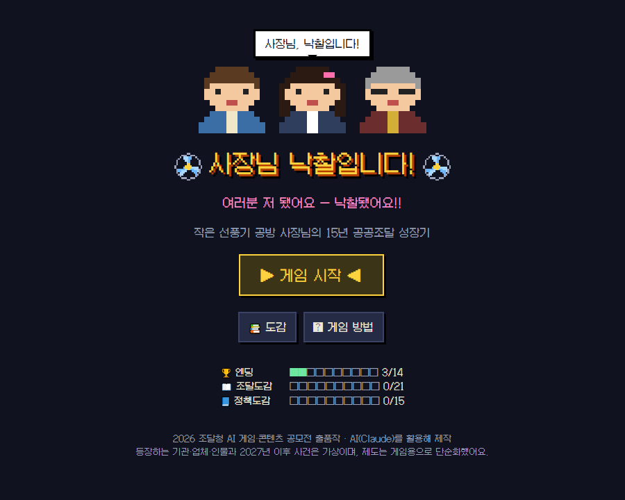
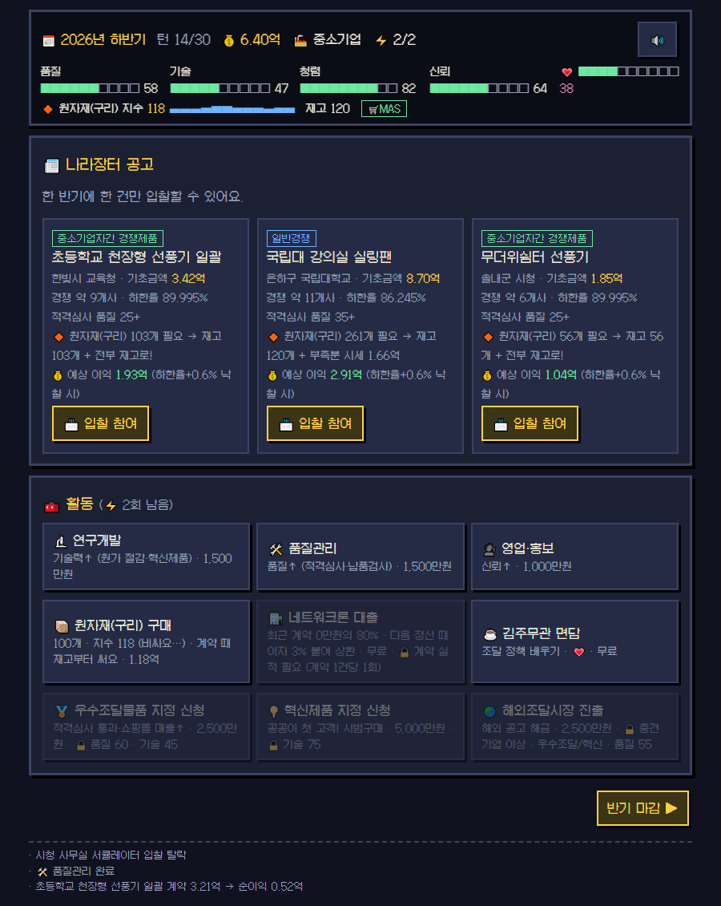
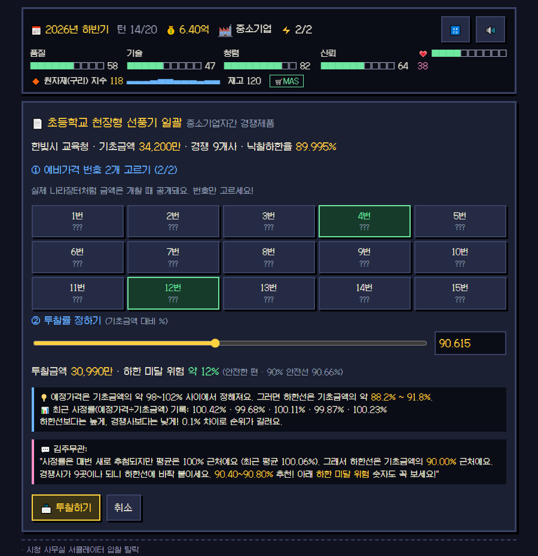
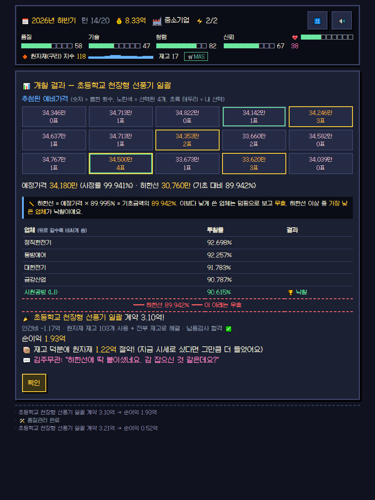
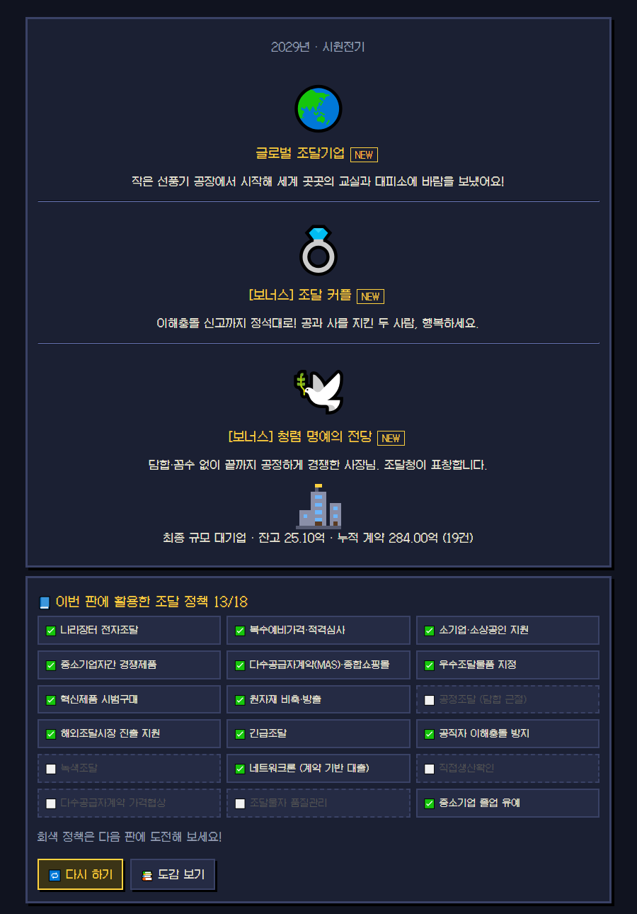

# 🌀 사장님 낙찰입니다!

> 여러분 저 됐어요 — 낙찰됐어요!!

작은 선풍기 공방 사장님이 되어 **2020년부터 2029년까지 10년 동안** 공공조달로 회사를 키우는 텍스트·도트 시뮬레이션 게임입니다.
복수예비가격, 낙찰하한율, 중소기업 지원 같은 실제 조달 제도를 직접 겪으면서 배울 수 있어요.

**▶ 바로 플레이: https://snbrlab.github.io/i-got-this/**

설치할 것 없이 PC·모바일 웹 브라우저에서 바로 실행됩니다. 오프라인에서는 `index.html` 파일을 열어도 돼요.

2026 조달청 AI 게임·콘텐츠 공모전 (AI 게임 부문) 출품작

---

## 게임 화면

### ① 나라장터 공고와 활동
공고마다 기초금액, 경쟁사 수, 낙찰하한율, 예상 이익이 표시돼요. 반기마다 1건에 입찰하고, 활동 2번으로 회사를 키워요.

### ② 예비가격 추첨과 투찰
번호 2개를 고르고 투찰률을 정해요. 하한 미달 위험도가 실시간으로 바뀌고, 김주무관이 데이터로 조언해 줘요.

### ③ 개찰 결과
하한선 아래는 덤핑으로 보고 무효, 그 위에서 가장 낮은 가격이 낙찰이에요.

### ④ 엔딩
엔딩과 함께 이번 판에 활용한 조달 정책을 정리해 보여줘요.

## 게임 소개

| | |
|---|---|
| 장르 | 경영 시뮬레이션 · 교육 |
| 분량 | 한 판 20턴 (1턴 = 반기) |
| 실행 환경 | PC · 모바일 웹 브라우저 |
| 조작 | 마우스 클릭 / 터치만으로 진행 |

### 등장인물
- **사장님 (나)**: 조용하고 튼튼한 선풍기를 만드는 작은 공방의 여사장. 현장 경력은 길지만 공공조달은 처음이에요.
- **김주무관**: 조달청 나라장터 교육 담당, 2년 차 연하 주무관. 제도는 빠삭한데 현장은 서툴고, 공과 사의 선은 누구보다 칼같이 지켜요.
- **박사장**: 경쟁사 대표. 들러리 입찰을 제안하는 업계 선배예요.

### 이렇게 플레이해요
1. **나라장터 공고에 입찰** (반기마다 1건)
   예비가격 15개 중 번호 2개를 고르고 투찰률을 써내요. 금액은 개찰 전까지 비공개! 가장 많이 뽑힌 4개의 평균이 예정가격이 되고, *예정가격 × 낙찰하한율* 이상이면서 가장 낮은 가격을 쓴 업체가 낙찰돼요.
2. **활동 2번**
   연구개발, 품질관리, 원자재 구매, 김주무관 면담, 직접생산확인(공장 실사), MAS·우수조달·혁신제품 신청 등을 할 수 있어요.
3. **반기 정산**
   매출과 고정비를 정산하고, 원자재 시세가 바뀌고, 돌발 사건이 터져요.

연매출이 늘면 회사가 **소기업 → 중소기업 → 중견기업 → 대기업**으로 커져요. 하지만 중견기업이 되는 순간 중소기업 전용 시장과 혜택을 잃어요. **성장할까, 지킬까?**

### 이런 재미가 있어요
- **진짜 같은 개찰**: 개찰 결과표에 하한선이 그어지고, 졌을 때는 "이번 입찰의 정답 구간"을 보여줘요. 하한 미달 위험도가 실시간으로 표시돼서 감으로 찍는 게 아니라 데이터로 투찰하게 돼요.
- **유혹과 선택**: 들러리 입찰 담합 제안, 회사 쪼개기(위장 중소기업), 경쟁사 설계도면 빼오기… 잘못된 선택은 언젠가 드러나요. 자진신고로 다시 시작할 수도 있어요.
- **김주무관**: 연하 신입 주무관이 상황에 맞는 조언과 정책 상식을 알려줘요. 커피 한 잔도 계좌이체로 돌려주는 원칙주의자예요. 사이가 가까워지면 *이해충돌 신고*를 할지 *비밀*로 할지 선택해야 해요.
- **실제 사건 연표**: 2020 팬데믹 긴급조달, 요소수 대란, 원자재 폭등과 비축물자 방출, 이해충돌방지법 시행, 2026 낙찰하한율 상향까지 실제 흐름을 따라가요. (2027년 이후는 가상 사건)
- **수집 요소**: 엔딩 14종, 조달도감 25개, 정책도감 18개. 판마다 활용한 정책을 체크해 다음 판에 다른 길로 도전할 수 있어요.

## 담긴 조달청 정책

| 정책 | 게임 속 모습 |
|---|---|
| 나라장터 전자조달 | 모든 공고와 입찰이 나라장터 화면에서 진행 |
| 복수예비가격 · 적격심사 | 예비가격 추첨, 예정가격, 낙찰하한율, 품질 심사 |
| 소기업·소상공인 수의계약 | 소액 공고는 경쟁 없이 수의계약 |
| 직접생산확인 | 공장 실사를 통과해야 중소기업자간 경쟁제품 공고에 참가 |
| 중소기업자간 경쟁제품 | 중소기업만 참가하는 공고, 중견기업이 되면 졸업 |
| MAS · 종합쇼핑몰 · 가격협상 | 입점하면 반기마다 쇼핑몰 주문, 연말엔 조달청과 단가 협상 |
| 조달물자 품질관리 · 계약 이행 | 납품 불시점검과 거래정지, 품질 미달로 이행 실패 시 계약 해지·보증금 몰수·입찰 제한 |
| 우수조달물품 · 혁신제품 시범구매 | 품질·기술 요건을 채워 지정 신청, 공공이 첫 고객 |
| 원자재 비축·방출 | 원자재 급등기에 조달청 비축 구리를 싸게 구매 |
| 네트워크론 | 계약서를 근거로 대출받고 납품대금으로 상환 |
| 공정조달 · 자진신고 감면 | 담합 적발, 입찰참가자격 제한, 리니언시, 처분 기한 |
| 공직자 이해충돌 방지 | 김주무관과의 관계를 신고하고 업무에서 회피 |
| 중소기업 졸업 유예 · 위장 중소기업 단속 | 성장 직후의 선택 |
| 긴급조달 · 녹색조달 · 해외조달 진출 | 재난 대응, 친환경 의무화, 해외 공고 해금 |

낙찰하한율은 물품 적격심사 기준을 게임용으로 단순화했고, 2026년 상향(일반 물품 +2%p, 중소기업자간 경쟁 물품 +2%p)을 반영했어요.

## AI 활용

- **Claude (Anthropic)**: 게임 기획, 시나리오·대사, 코드 작성, 조달 제도 정리, 밸런스 시뮬레이션
- 도트 캐릭터와 선풍기 아이콘은 이미지 파일 없이 코드로 직접 그렸어요.
- 폰트: [Galmuri](https://github.com/quiple/galmuri) © Lee Minseo, SIL Open Font License 1.1 ([OFL-Galmuri.md](OFL-Galmuri.md)). 인터넷 없이도 똑같이 보이도록 `index.html`에 내장했어요.

등장하는 기관·업체·인물과 2027년 이후 사건은 가상이며, 제도는 게임용으로 단순화했습니다.

---

개발 메모

- `index.html` 한 파일(폰트 내장, 외부 의존성 없음), 빌드·서버 없음. main에 push하면 GitHub Actions(`.github/workflows/pages.yml`)가 Pages로 배포
- 저장: 진행 `pps_save`(허브 진입 시 저장), 수집 `pps_col` (localStorage)
- 하한율 `FR`: 소액·일반 84.245 / 중소경쟁 87.995 / 대형·해외 80.495%. 턴12 일반 +2%p, 턴13 중소경쟁 +2%p
- 규모 기준(연매출): 2/20/100억. 반기 고정비 0.04/0.1/0.6/2.5억, 활동비 배수 1/2/7/20. 승급은 직전 1년, 강등은 3년 평균 기준. 졸업유예 6턴
- 품질·기술: 활동 1회당 `(100-x)×0.15+1.5`(시작 품질 25·기술 20), 반기마다 노후화 -1. 한 능력치에 집중하면 100 도달 가능(첫 달성 시 토스트)
- 신뢰: 계약·점검·사건으로 변동. 60 이상이면 공고 +1, 적격심사 점수 = 품질 + 신뢰÷10 (`qScore`), 쇼핑몰 주문량 반영
- 직접생산확인(`dpc`) 없으면 중소경쟁 공고 불가. 턴15 감독 강화 이후 납품한 반기 35% 불시점검(품질 55↑ 합격 / 40↓ 거래정지 1턴)
- MAS 갱신 협상(`negotiation`): 매 하반기 정산, 성공률 `negoP` = 품질·신뢰, 이익률 25→최대 45%. 활동이 아니라 사건인 이유: 활동 슬롯을 쓰면 품질·기술 투자 대비 항상 손해(시뮬 확인)
- 계약 이행(`execRisk`): 공고 난이도-품질 차이 g → 지체상금 확률 g/60(최대 60%), g>15면 계약 해지 확률 (g-15)/40(최대 60%). 해지 시 대금 없음·보증금 10% 몰수·원가 손실·다음 반기 입찰 제한·신뢰 -15. 공고 카드에 위험도 표시
- 엔딩: 최고 도달 규모 기준. 대기업+해외 낙찰 2건 → 글로벌, 대기업 → 회장님, 혁신제품+기술75 → 혁신, …
- 입찰: 하한 미달 위험도 `floorRisk`(예정가격 표준편차 ≈ 0.58%), 투찰 조언 `bidTip`, 담합 제안 8%·6턴 쿨다운, 처분 기한 10턴(`collTurns`)
- 김주무관: 조언 `kimAdvice`, 반응 `REACT`/`REACT_LOVE`, 호감은 카페 이벤트 `sparkEvent` 이후 `MOMENTS` 선택지·`DATES`로만 상승, 턴16 6급 승진·턴19(마지막 반기) 혁신조달 업무 발령(호칭은 주무관 유지)
- 자금: 첫 바닥 시 창업 지원자금 1.5억, 이후 최근 계약 기반 네트워크론 자동 적용
- 밸런스(봇 300판, 20턴): 투자형 플레이 시 엔딩이 글로벌 ~38 / 대기업 회장님 ~25 / 중견기업 ~21 / 강소기업 장인 ~9 / 혁신 ~4%, 파산 ~3%. 김주무관 위주 플레이는 중견기업·강소기업 장인·혁신 쪽이 늘어남

**제출 (마감 2026-11-22)**: 참가신청서 PDF, 개인정보동의서 PDF, 시연영상 MP4(1분 내외·1080p), 실행파일 ZIP(`index.html` + `OFL-Galmuri.md`) → dnccompany3@daum.net

